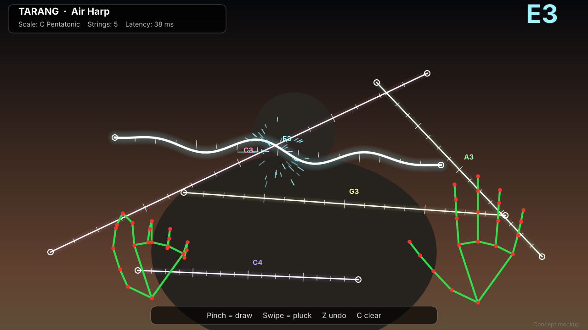
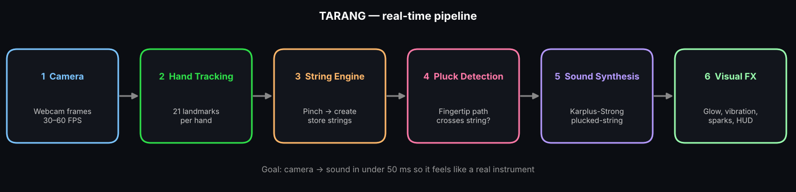
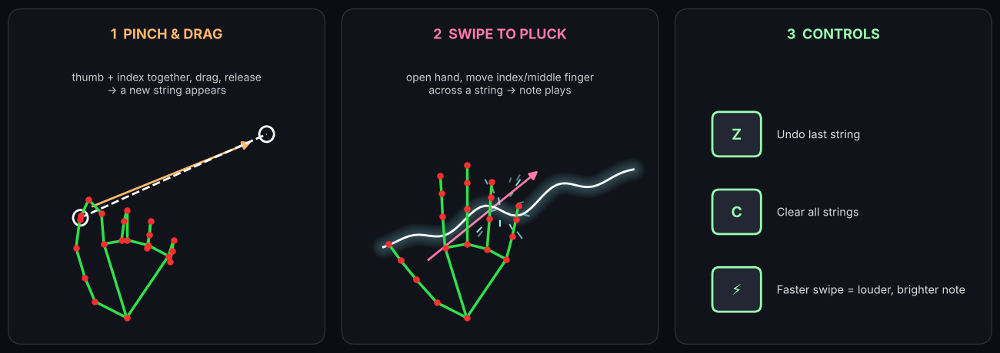
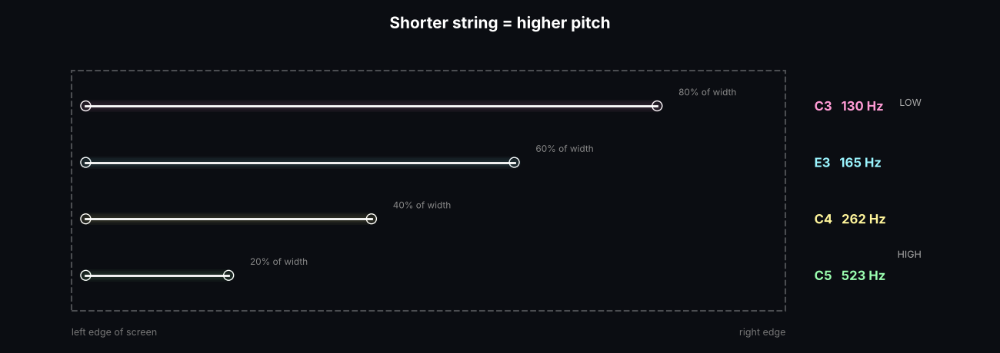

# Tarang — Air Harp

**Play a harp in thin air. No instrument, no touch, just your hands and a webcam.**

Tarang is a real-time computer-vision music project. You draw invisible strings in the air with your fingers, and the length of each string decides its pitch. Swipe a finger across a string and it plays a plucked-string note, with glowing visuals and sparks.

> *Tarang* means "wave" in Hindi — a nod to both sound waves and hand waves.

> **Note:** The images below are **concept mockups** showing how the finished project should look and behave. Replace them with real screenshots and a demo GIF once the build works (see the "Demo" section).

---

## Demo

*Concept mockup: five glowing strings, hand skeletons tracked live, one string vibrating after a pluck, current note shown top-right, small HUD on top-left.*

**Where the real demo goes (to fill in after the build):**

| Slot | What to add |
|---|---|
| Hero GIF | 10 second loop: draw a string, pluck it, sparks fly |
| Screenshot 1 | Single string being drawn (pinch and drag) |
| Screenshot 2 | Multiple strings with different colours |
| Screenshot 3 | Pluck moment with vibration and sparks |
| Video link | Full reel or YouTube demo |

---

## Inspiration and Credit

The idea comes from an Instagram reel by **@sonicdeadhorse**, who showed strings drawn in midair with hand tracking. Tarang is an independent reimplementation and extension of that concept, built for learning. All code, visuals and design in this repo are original.

---

## What It Does

1. **Draw strings:** Pinch your thumb and index finger, drag, and release. A string stays hanging in the air between the two points.
2. **Pluck strings:** Swipe a fingertip across a string and it sounds, louder if you swipe faster.
3. **Length = pitch:** Long strings sound low, short strings sound high.
4. **Always in tune:** Notes snap to a musical scale, so random strings still sound good together.
5. **Look cool:** Strings glow, wobble after a pluck, and throw sparks.

---

## How It Works

| Stage | What happens |
|---|---|
| 1. Camera | Webcam frames come in live |
| 2. Hand tracking | A hand-landmark model finds 21 points on each hand, every frame |
| 3. String engine | A pinch gesture creates a string between two points and stores it |
| 4. Pluck detection | If a fingertip's movement path crosses a string, that string is plucked |
| 5. Sound synthesis | A physical-modelling plucked-string algorithm creates the note in real time |
| 6. Visual effects | Glow, vibration, sparks and a small HUD are drawn over the video |

**Latency target:** under 50 ms from finger movement to sound. If the delay is bigger, it stops feeling like an instrument.

---

## Gestures

| Gesture | Result |
|---|---|
| Pinch thumb and index, drag, release | Creates a new string |
| Open hand, swipe index or middle finger across a string | Plucks the string |
| Faster swipe | Louder, brighter note |
| Z key | Undo last string |
| C key | Clear all strings |

---

## Pitch Mapping

| String length (share of screen width) | Note | Approx. frequency |
|---|---|---|
| 80% | C3 | 130 Hz |
| 60% | E3 | 165 Hz |
| 40% | C4 | 262 Hz |
| 20% | C5 | 523 Hz |

Every halving of the length raises the pitch by one octave, exactly like a real string. The result is then snapped to a **pentatonic scale** so nothing sounds out of tune.

---

## Features

**Core (version 1)**
- Live hand tracking for up to two hands
- Pinch-to-draw strings, unlimited count
- Pluck detection with velocity-based volume
- Plucked-string sound that feels realistic
- Glow, vibration and spark visuals
- Undo and clear

**Version 2 ideas**
- Choose scale: pentatonic, major, minor, or Indian raags (Yaman, Bhairavi)
- Instrument presets: harp, sitar, guitar, synth pluck
- Reverb and delay controls
- Save and load string layouts
- Record audio and screen as a video for reels
- Mobile support

**Stretch goals**
- Strum several strings at once with a sweeping hand
- Two-player mode over the network
- MIDI output so it can control any DAW
- Bowing and sustain gesture (hold a string to keep it ringing)

---

## Tech Stack

| Layer | Choice | Why |
|---|---|---|
| Platform | Browser (single page) | Easy to share, great for demo reels |
| Hand tracking | MediaPipe Hands | Fast, accurate, free |
| Audio | Web Audio API | Low latency, no install |
| Sound model | Karplus-Strong synthesis | Realistic pluck with very little compute |
| Drawing | HTML canvas | Simple and fast for glow effects |

**Alternative path:** Python with OpenCV, MediaPipe and a sound library, if you prefer a desktop app.

---

## Build Roadmap

| Phase | Goal | Done when |
|---|---|---|
| 1 | Webcam and hand skeleton on screen | You see your hand tracked live |
| 2 | Pinch gesture creates a string | A line stays in the air after release |
| 3 | Pluck detection | Console or screen reacts when a finger crosses a string |
| 4 | Sound | Plucking plays a note, length changes pitch |
| 5 | Scale snapping and velocity | Always sounds musical, soft and hard plucks differ |
| 6 | Visual polish | Glow, vibration, sparks, HUD |
| 7 | Demo and release | README images replaced, reel recorded, repo public |

---

## Challenges and How to Handle Them

| Challenge | Idea to solve it |
|---|---|
| Pinch triggers by accident while plucking | Use two thresholds (start pinch and release pinch) and ignore plucks while pinching |
| Same string plays many times in one swipe | Add a short cooldown per string |
| Jittery hand tracking | Smooth landmarks slightly over a few frames |
| Audio delay | Pre-generate notes, keep audio buffers small |
| Poor lighting breaks tracking | Add a warning when confidence drops, recommend a bright front light |
| Mirror confusion | Flip the video so it behaves like a mirror |

---

## Resume and Portfolio Angle

You can describe it like this:

- Built a **real-time gesture-controlled musical instrument** using computer vision and audio synthesis, with sub-50 ms latency.
- Implemented **geometric collision detection** between fingertip trajectories and virtual strings.
- Applied **physical-modelling synthesis** (Karplus-Strong) to generate realistic plucked-string audio live in the browser.
- Designed a **low-latency pipeline** from camera frames to audio output, with smoothing and debouncing for noisy sensor data.

Why it fits a quant or low-latency path: it shows you can build and optimise a real-time system where every millisecond in the pipeline matters, and you can measure it.

---

## Demo Reel Shot List

1. **Hook (0–2 s):** Empty frame, you raise your hand. A string appears.
2. **Build (2–8 s):** Draw four to five strings of different lengths, each lighting up in a new colour.
3. **Play (8–20 s):** Perform a simple melody by plucking.
4. **Wow (20–25 s):** Fast sweep across all strings with sparks.
5. **Outro (25–30 s):** Project name, "Built from scratch", GitHub link.

**Filming tips:** dark room, plain background, bright light on your hands, record screen audio directly instead of using the mic.

---

## Suggested Repo Structure

- README with demo GIF at the top
- An assets folder for screenshots and GIFs
- A docs folder for design notes and the latency measurements
- The app source
- A licence file

---

## Success Criteria

- A new user can draw and play a string within 10 seconds, with no instructions.
- Latency stays under 50 ms on a normal laptop.
- Any combination of strings sounds pleasant.
- The demo reel is smooth enough to post.

---

## Status

Idea and design complete. First working prototype in progress.
